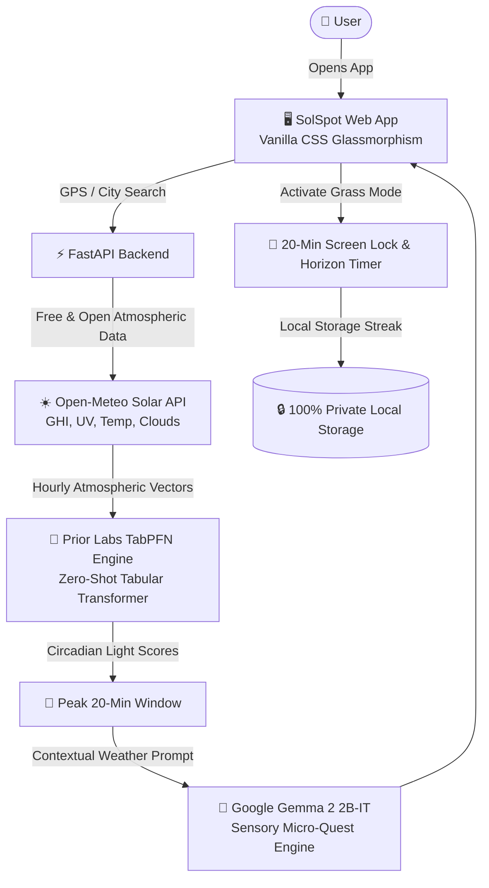

# 🌿 SolSpot — The Anti-Burnout Natural Light Optimizer

> **Hacktoberfest Open-Source AI Challenge: Week 1 — "Touch Grass" Submission**  
> Tag: `#hf26challenge`  
> Target Prize Categories: **Best Use of TabPFN (Prior Labs)** ($200) & **Best Use of Gemma (Google)** ($200)

---

## 💡 What We Built & The Problem

Remote workers, engineers, and creators spend an average of 9+ hours a day bathed in unnatural 6500K LED screen glare. This suppresses natural melatonin timing, elevates chronic stress, and leads to screen burnout. 

Most health apps demand *more screen time*: tracking food, counting reps, or reading lengthy meditation guides. 

**SolSpot is designed with one core philosophy: Make the screen the shortest part of the experience.**

SolSpot analyzes hyper-local atmospheric and solar data (GHI irradiance, direct blue-spectrum light, UV index, cloud filtering, and thermal indices) to pinpoint your personal **Peak 20-minute "Touch Grass" Window** of the day.

When your window arrives, SolSpot launches **Grass Mode**: a soothing, distraction-free screen lock with a 20-minute outdoor countdown and breathing guide that instructs you to **turn your phone facedown on your desk and look at the horizon**.

---

## 🧠 Open-Source AI at its Core: Why Open Innovation Matters

### 1. TabPFN (Prior Labs) — Zero-Shot Tabular Circadian Modeling
Circadian light quality is multidimensional tabular data: solar zenith angle, GHI irradiance, UVB ratio, cloud cover percentages, ambient temperature, and wind chill. 
- Traditional machine learning models require hundreds of hyperparameter iterations and thousands of localized rows to calibrate.
- **Prior Labs' TabPFN** is a transformer foundation model trained on synthetic tabular datasets that performs instantaneous zero-shot in-context learning. SolSpot feeds hourly atmospheric observations through TabPFN to predict circadian wellness scores without needing heavy training pipelines.

### 2. Google Gemma 2 (2B-IT) — 60-Second Sensory Micro-Quests
When you step outside, your brain often stays stuck in work mode. SolSpot uses **Google's Gemma 2** to generate tailored outdoor sensory micro-quests:
- Weather and solar-adapted (e.g., *"Step outside into the morning light and face 45 degrees away from the direct sun. Close your eyes for 30 seconds and let the photons warm your eyelids. Put your phone in your pocket."*)
- Forces engagement of non-screen senses (skin temperature, proprioception, 20-20-20 visual horizon focus).

### 3. Open-Meteo & Zero-Tracking Privacy
Unlike proprietary fitness trackers that monetize your location and schedule:
- SolSpot queries **Open-Meteo**, a community-backed, open-source atmospheric API requiring zero proprietary API keys or user IDs.
- Your personal daylight habits and location coordinates **never leave your device**.

---

## 🏗️ Architecture



---

## 🌐 Live Demo & Deployment
- **Live Web App**: [https://solspot.onrender.com](https://solspot.onrender.com)
- **API Health**: [https://solspot.onrender.com/api/health](https://solspot.onrender.com/api/health)

---

## 🚀 Quickstart & Local Setup

### 1. Clone & Enter Directory
```bash
git clone https://github.com/YadneshTeli/Solspot.git
cd Solspot
```

### 2. Set Up Virtual Environment & Dependencies
```bash
# Using uv (recommended for ultra-fast setup):
uv venv --python 3.12 .venv
.\.venv\Scripts\activate
uv pip install -r requirements.txt
```

### 3. (Optional) Prior Labs TabPFN & Hugging Face Tokens
SolSpot includes high-precision offline fallbacks so it runs immediately with zero setup. To use live cloud weights:
```bash
# Optional: Prior Labs TabPFN key from https://ux.priorlabs.ai/
export TABPFN_TOKEN="your_prior_labs_key"

# Optional: Hugging Face Token for Gemma 2
export HF_TOKEN="your_huggingface_token"
```

### 4. Run SolSpot
```bash
python run.py
```
Open **[http://localhost:8000](http://localhost:8000)** in your browser!

---

## 🌿 How to Use
1. **Detect / Pick Location**: Tap **Locate** to use your current GPS, or search any city in the search bar.
2. **Review Your Golden Window**: Look at the circadian score ring and inspect the animated solar trajectory arc across dawn, solar noon, and dusk.
3. **Read Your Gemma Micro-Quest**: Review your 60-second sensory mission tailored to current conditions.
4. **Hit "Activate Grass Mode"**: Place your phone facedown or step away from your computer. Soak in 20 minutes of natural daylight.
5. **Collect Your Badge**: Return and claim your "Natural Light Pioneer" badge to build your daily outdoor streak!

---

## 📜 License
MIT License — Free and Open Source for everyone.
